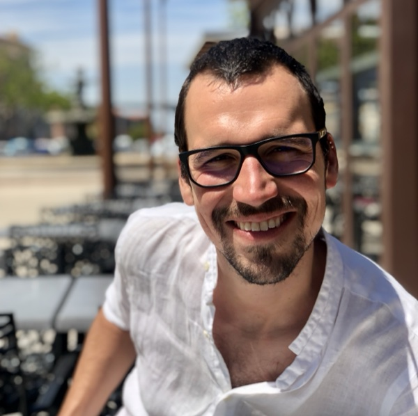

```{r setup}
#| include: false
source("R/cv_functions.R")
cv <- create_cv()
```

::: {.lse-hero}
::: {.lse-section}
::: {.lse-hero-grid}
::: {.lse-hero-text}

# Lars Schöbitz

```{r role, results='asis'}
print_role_line(cv)
```

```{r lead, results='asis'}
print_lead(cv, "intro")
```

::: {.lse-actions}
[Read the CV](cv.qmd){.btn .btn-primary}
[Teaching and talks](teaching.qmd){.btn .btn-outline}
:::

```{r contact-hero, results='asis'}
print_contact_links(cv, skip = "globe")
```

:::
::: {.lse-hero-photo}
{.lse-portrait fig-alt="Portrait of Lars Schöbitz"}
:::
:::

```{r numbers, results='asis'}
print_numbers(cv)
```

:::
:::

```{r upcoming, results='asis'}
print_upcoming_cards(cv)
```

::: {.lse-tint}
::: {.lse-section}

## Recent talks and materials

```{r recent, results='asis'}
print_recent_cards(cv, limit = 3)
```

[All talks and workshops](teaching.qmd){.lse-more}

:::
:::

::: {.lse-section}

## Latest writing

```{r writing, results='asis'}
print_latest_rows(cv, "blog", limit = 3)
```

[All posts](blog.qmd){.lse-more}

:::

::: {.lse-tint}
::: {.lse-section}

## Explore

```{r explore, results='asis'}
print_explore_cards(cv)
```

:::
:::

::: {.lse-band}
::: {.lse-band-inner}

## Get in touch

```{r contact-band, results='asis'}
print_contact_links(cv, skip = "globe")
```

:::
:::
